# E-Commerce (Next.js + .NET 9)

ระบบเลือกซื้อสินค้า ตะกร้าสินค้า Checkout และหน้าดู Stock

```
backend/   ECommerce.API   (.NET 9 Web API, N-Tier: Controllers → Services → Repositories → Data)
           ECommerce.Tests (xUnit: ทดสอบ logic ของ Stock)
frontend/  Next.js + Untitled UI React
```

## วิธีรัน

### 1. Backend (http://localhost:5100)
```bash
cd backend/ECommerce.API
dotnet run
```
- ตอน start ระบบจะรัน migration ให้อัตโนมัติ: สร้าง DB `ECommerceDB` บน `LAPTOP-0EI6JICQ\SQLEXPRESS` และใส่สินค้า mock 12 รายการ
- Swagger: http://localhost:5100/swagger
- Connection string อยู่ใน `appsettings.json`

### 2. Frontend (http://localhost:3000)
```bash
cd frontend
npm install
npm run dev
```
URL ของ API ตั้งค่าใน `frontend/.env.local` (`NEXT_PUBLIC_API_URL`)

## หน้าจอ
| หน้า | URL |
|---|---|
| เลือกซื้อสินค้า | `/` |
| ตะกร้าสินค้า + Checkout | `/cart` |
| สรุปคำสั่งซื้อ | `/orders/{id}` |
| Stock สินค้า | `/stock` |

## การทำงานของระบบ
ภาพทั้งหมดถ่ายจากระบบจริง (ต่อ SQL Server) ตามลำดับการใช้งาน ข้อมูลตั้งต้นคือ เมาส์ไร้สาย (P001) Stock 47 ชิ้น และ เว็บแคม (P007) Stock 5 ชิ้น
แต่ละขั้นอ้างอิงเทสที่ตรวจ logic เดียวกันไว้ใน [การทดสอบ](#การทดสอบ-unit-tests)

### 1. หน้าเลือกซื้อสินค้า
แสดงสินค้าทั้งหมด พร้อม badge **ใกล้หมด** (พร้อมขาย ≤ 5) และ **สินค้าหมด** การ์ดที่หมดแล้วไม่มีปุ่มให้กด

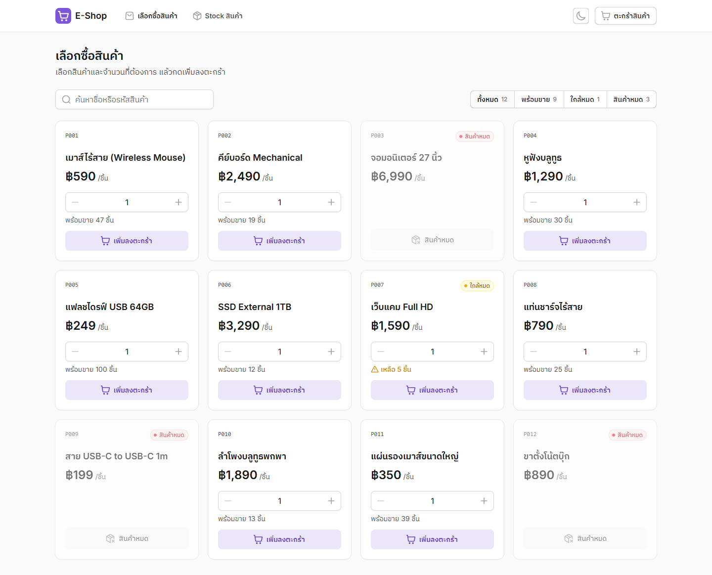

### 2. เพิ่มสินค้าลงตะกร้า = จอง Stock
เมื่อปรับจำนวน ปุ่มจะเปลี่ยนเป็นสีเต็ม "เพิ่มลงตะกร้า (2)" เพื่อบอกว่ามีรายการรอกด

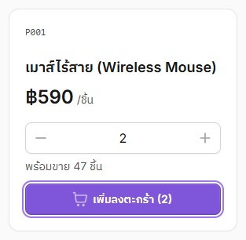

กดแล้วสินค้าถูก **จอง** (ReservedQty +2) พร้อมขายลดจาก 47 เหลือ 45 การ์ดขึ้น badge "ในตะกร้า 2" ตัวเลขบนไอคอนตะกร้าอัปเดต และมี toast ยืนยัน
→ เทส `AddItem_ReservesStock_AndComputesTotal`

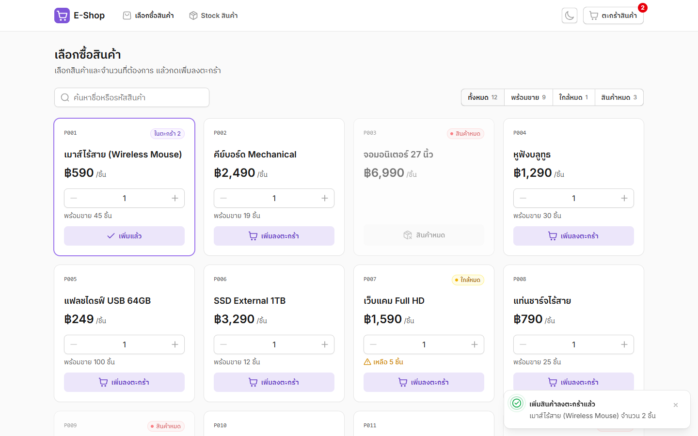

### 3. Validation: Stock ไม่พอเพิ่มไม่ได้
| ใส่จำนวนเกินที่เหลือ | จองครบทั้งหมดแล้ว | ตะกร้าของคนอื่นเห็นว่าหมด |
|---|---|---|
| 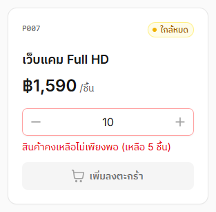 | 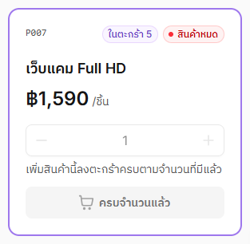 | 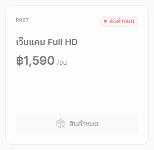 |
| ขอ 10 แต่เหลือ 5 → แจ้งเตือนและกดไม่ได้ | ใส่ครบ 5 ชิ้น → ปุ่ม "ครบจำนวนแล้ว" | เปิดอีก browser (อีกตะกร้า) → ขึ้นสินค้าหมด เพราะถูกจองไปแล้ว |
| `AddItem_MoreThanAvailable_ThrowsAndKeepsStock` | `UpdateItem_AboveAvailable_Throws` | `AddItem_ReservedByAnotherCart_IsNotAvailable` |

Backend ตรวจซ้ำอีกชั้น ถ้าเรียก API เกินจำนวนจะตอบ `409` พร้อมข้อความ "สินค้า X คงเหลือไม่เพียงพอ (เหลือ n ชิ้น)"

### 4. หน้า Stock: เห็นยอดจองทันที
**คงเหลือ** (ของจริงในคลัง) ยังไม่ลด แต่ **ถูกจอง** เพิ่มขึ้น และ **พร้อมขาย** = คงเหลือ − ถูกจอง (P001: 47 − 2 = 45, P007: 5 − 5 = 0)

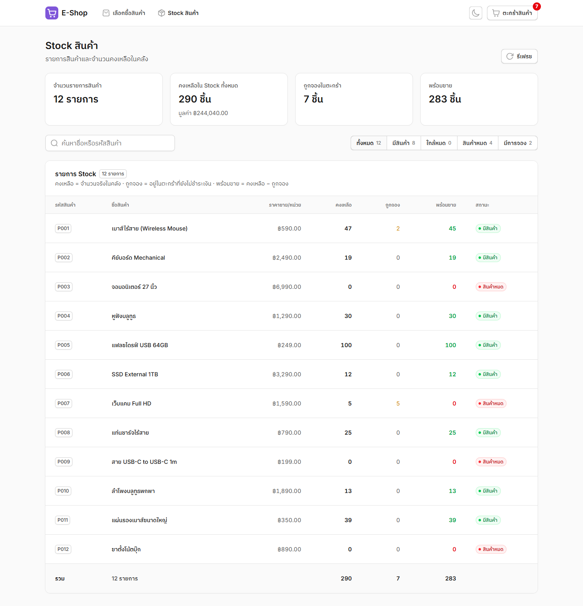

### 5. ตะกร้าสินค้า: เพิ่ม / ลด / ลบ / ล้างตะกร้า
ปรับจำนวนด้วยปุ่ม + / − ลบทีละรายการ หรือล้างทั้งหมด ทุกการกระทำปรับยอดจองให้ถูกต้อง ถ้าจองครบแล้วปุ่ม + จะกดไม่ได้และขึ้น "ครบจำนวนแล้ว (สูงสุด 5 ชิ้น)"
→ เทส `UpdateItem_IncreaseAndDecrease_AdjustsReservation`, `RemoveItem_ReleasesReservation`, `Clear_ReleasesAllReservations`

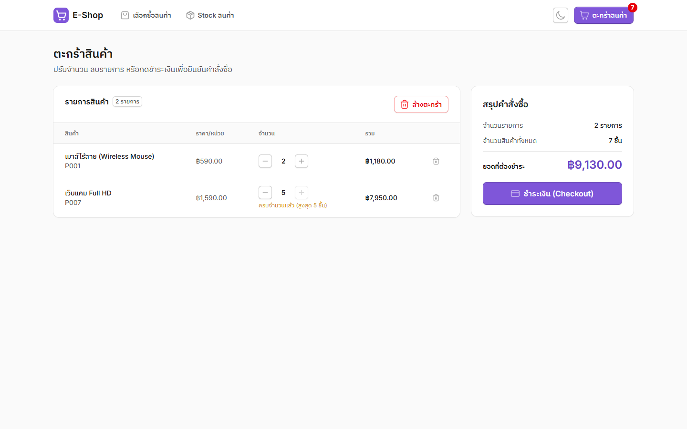

ล้างตะกร้าต้องยืนยันก่อน และจะคืนยอดจองกลับเข้า Stock

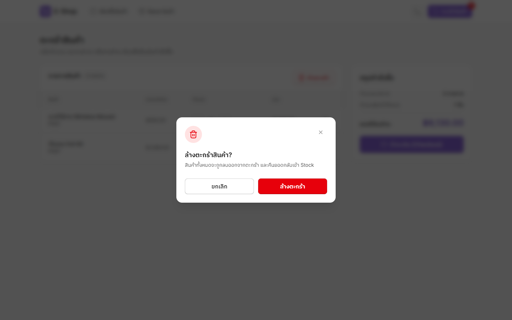

### 6. Checkout: แสดงยอดที่ต้องชำระ แล้วตัด Stock
ก่อนยืนยันจะแสดงรายการและ **ยอดที่ต้องชำระ** (590 × 2 + 1,590 × 5 = ฿9,130)

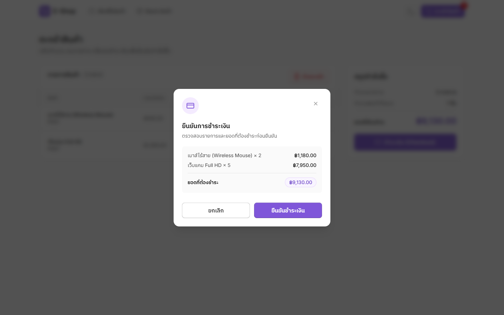

ยืนยันแล้วบันทึก Order และแสดงหน้าสรุป
→ เทส `Checkout_CutsStock_ReleasesReservation_AndEmptiesCart`

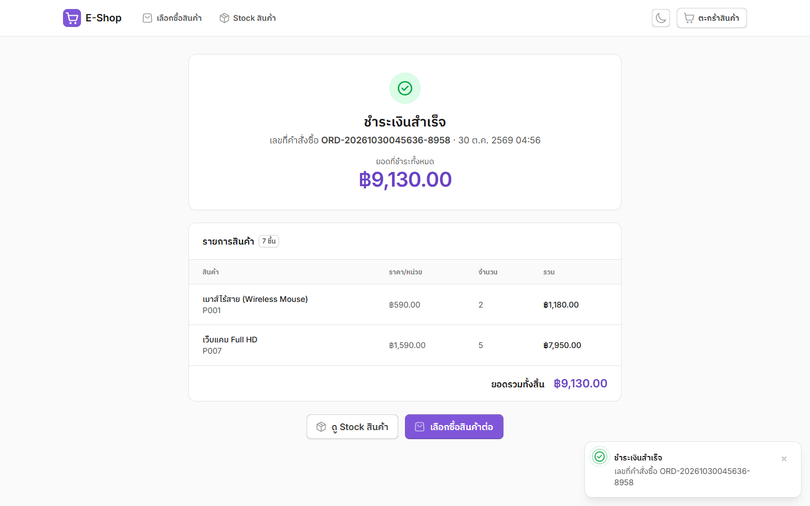

### 7. Stock หลัง Checkout
Stock จริงถูกตัด (P001: 47 → 45, P007: 5 → 0) และยอดจองกลับเป็น 0 เพราะของออกจากตะกร้าแล้ว

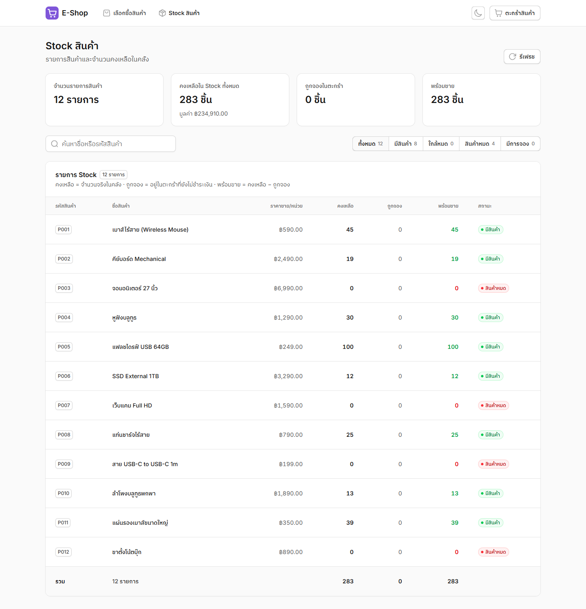

### 8. ค้นหาและกรองสินค้า
ค้นหาได้ทั้งชื่อและรหัสสินค้า (ไม่สนตัวพิมพ์เล็กใหญ่) ข้อความที่ตรงกันจะถูก highlight และกรองตามสถานะได้ (ทั้งหมด / พร้อมขาย / ใกล้หมด / สินค้าหมด) ใช้ได้ทั้งหน้าเลือกซื้อและหน้า Stock

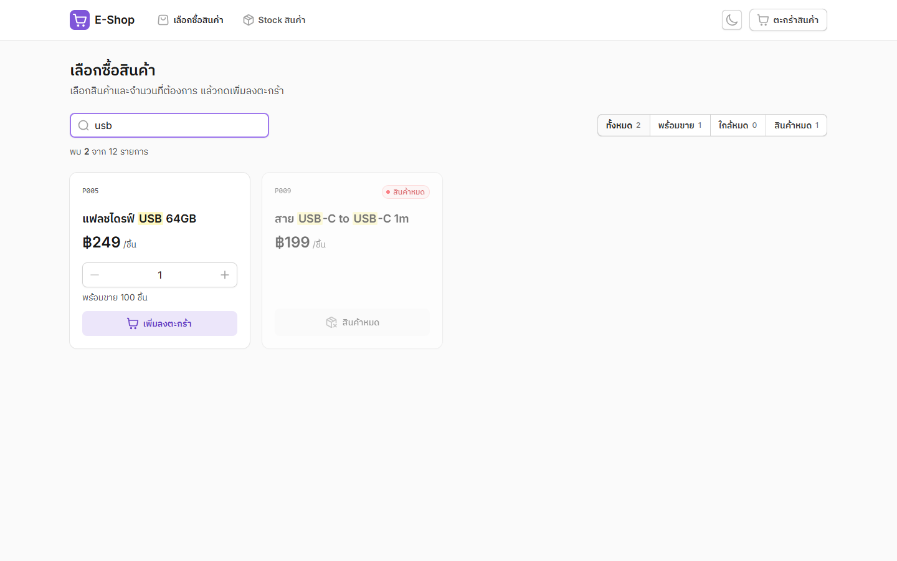

### 9. Light / Dark mode
สลับ theme ได้จากปุ่มมุมขวาบน ระบบจำค่าที่เลือกไว้

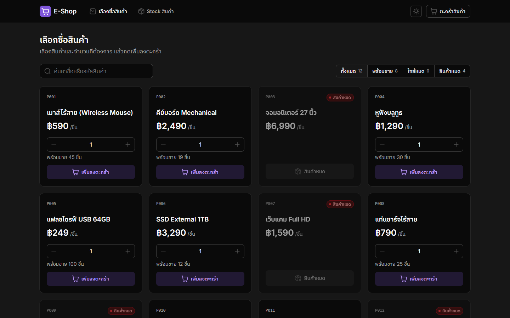

## ฐานข้อมูล (ER Diagram)
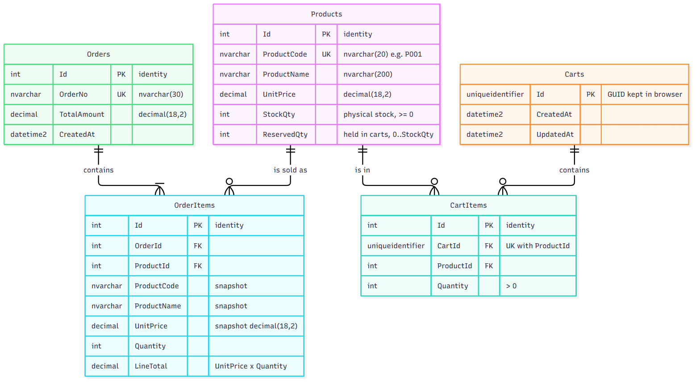

| ตาราง | หน้าที่ |
|---|---|
| **Products** | ข้อมูลสินค้าและ Stock (สินค้า mock 12 รายการใส่ผ่าน migration) |
| **Carts** | ตะกร้าสินค้า ระบุด้วย GUID ที่ browser เก็บไว้ใน localStorage |
| **CartItems** | สินค้าในตะกร้า แต่ละรายการ **จอง** Stock ไว้ |
| **Orders** | คำสั่งซื้อที่ Checkout แล้ว |
| **OrderItems** | รายการสินค้าในคำสั่งซื้อ เก็บรหัส ชื่อ และราคา ณ ตอนซื้อ (snapshot) |

| ความสัมพันธ์ | Cardinality | เมื่อลบแม่ |
|---|---|---|
| Carts → CartItems | 1 : 0..N | Cascade |
| Products → CartItems | 1 : 0..N | Restrict |
| Orders → OrderItems | 1 : 1..N | Cascade |
| Products → OrderItems | 1 : 0..N | Restrict |

Constraints:
- `Products`: `UNIQUE (ProductCode)`, `CHECK (StockQty >= 0)`, `CHECK (ReservedQty >= 0 AND ReservedQty <= StockQty)`
- `CartItems`: `UNIQUE (CartId, ProductId)`, `CHECK (Quantity > 0)`
- `Orders`: `UNIQUE (OrderNo)`
- จำนวนพร้อมขาย (Available) = `StockQty − ReservedQty` คำนวณใน code ไม่ได้เก็บเป็นคอลัมน์

## กฎของ Stock (จอง + ตัดจริง)
- `StockQty` = จำนวนจริงในคลัง, `ReservedQty` = ถูกจองอยู่ในตะกร้า, `Available` = Stock − Reserved
- เพิ่มสินค้าลงตะกร้า / กด + : ถ้า Available ไม่พอจะตอบ 409 "สินค้า X คงเหลือไม่เพียงพอ" ถ้าพอจะเพิ่ม `ReservedQty`
- กด − / ลบรายการ / ล้างตะกร้า : คืนยอด `ReservedQty`
- Checkout : ตัด `StockQty` และ `ReservedQty` บันทึก Order/OrderItems แล้วล้างตะกร้า โดยทั้งหมดอยู่ใน `SaveChanges` ครั้งเดียว
- กันการแก้ไขชนกันด้วย optimistic concurrency (`StockQty`/`ReservedQty` เป็น concurrency token และ retry 3 ครั้ง) พร้อม check constraint `0 <= ReservedQty <= StockQty`

## การทดสอบ (Unit Tests)

### ภาพรวม
- โปรเจ็ค `backend/ECommerce.Tests` ใช้ **xUnit** ทดสอบ **ชั้น Service** (`CartService`, `OrderService`) ซึ่งเป็นที่อยู่ของกฎเรื่อง Stock ทั้งหมด
- ไม่ต่อ SQL Server จริง ใช้ **EF Core InMemory** เป็น DB ปลอมในหน่วยความจำ แต่ละเทสได้ DB ใหม่ของตัวเอง (ตั้งชื่อด้วย `Guid.NewGuid()`) เทสจึงไม่ปนกัน
- แต่ละเทสเขียนแบบ **Arrange → Act → Assert**: เตรียมข้อมูล → เรียกฟังก์ชัน → ตรวจผล
- ข้อมูลตั้งต้นทุกเทส: **Mouse** (ราคา 100, Stock 10) และ **Cable** (ราคา 50, Stock 3)

### วิธีรัน
```bash
cd backend
dotnet test
```
ผลที่ถูกต้อง: `Passed! - Failed: 0, Passed: 12`

### รายการเทส
**`CartServiceTests` (9 เทส): ตะกร้าสินค้า**
| เทส | ตรวจว่า |
|---|---|
| `AddItem_ReservesStock_AndComputesTotal` | ใส่ Mouse 3 ชิ้น → จองเพิ่ม 3, Stock จริงยังเป็น 10, ยอดรวม 300 |
| `AddItem_SameProductTwice_MergesQuantity` | ใส่สินค้าเดิมซ้ำ (2 + 4) → รวมเป็นแถวเดียว 6 ชิ้น |
| `AddItem_MoreThanAvailable_ThrowsAndKeepsStock` | Cable เหลือ 1 แต่ขอ 2 → error "เหลือ 1 ชิ้น" และยอดจองไม่เปลี่ยน |
| `AddItem_ReservedByAnotherCart_IsNotAvailable` | ตะกร้า A จอง Cable หมดแล้ว → ตะกร้า B ใส่ไม่ได้ |
| `UpdateItem_IncreaseAndDecrease_AdjustsReservation` | ปรับจำนวน 2 → 5 → 1 แล้วยอดจองตามถูกทุกครั้ง |
| `UpdateItem_AboveAvailable_Throws` | ปรับเกินที่เหลือ → error และยอดจองเดิมไม่เปลี่ยน |
| `RemoveItem_ReleasesReservation` | ลบรายการ → คืนยอดจองเฉพาะสินค้านั้น ส่วนอื่นไม่เปลี่ยน |
| `Clear_ReleasesAllReservations` | ล้างตะกร้า → คืนยอดจองทุกสินค้า และตะกร้าว่าง |
| `UnknownCart_ThrowsNotFound` | เรียกตะกร้าที่ไม่มีอยู่ → NotFound (404) |

**`OrderServiceTests` (3 เทส): Checkout**
| เทส | ตรวจว่า |
|---|---|
| `Checkout_CutsStock_ReleasesReservation_AndEmptiesCart` | Checkout Mouse 3 + Cable 3 → ยอด 450, Stock ลดจริง (10→7, 3→0), ยอดจองกลับเป็น 0, ตะกร้าว่าง |
| `Checkout_DoesNotTouchOtherCartsReservation` | Checkout ตะกร้าเรา (2 ชิ้น) → ยอดจองของตะกร้าอื่น (5 ชิ้น) ยังอยู่ครบ |
| `Checkout_EmptyCart_Throws` | ตะกร้าว่าง → Checkout ไม่ได้ และไม่มี Order เกิดขึ้น |


## API
| Method | Route |
|---|---|
| GET | `/api/products` |
| POST | `/api/carts` |
| GET | `/api/carts/{cartId}` |
| POST | `/api/carts/{cartId}/items` `{ productId, quantity }` |
| PATCH | `/api/carts/{cartId}/items/{productId}` `{ quantity }` |
| DELETE | `/api/carts/{cartId}/items/{productId}` |
| DELETE | `/api/carts/{cartId}/items` |
| POST | `/api/carts/{cartId}/checkout` |
| GET | `/api/orders/{id}` |
